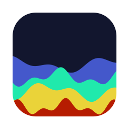
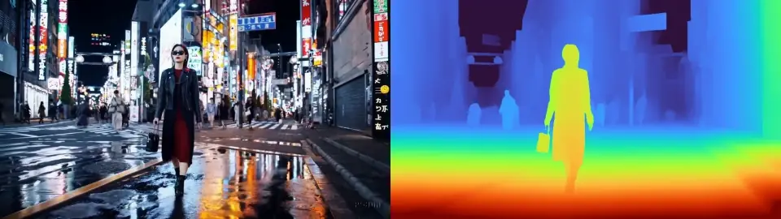
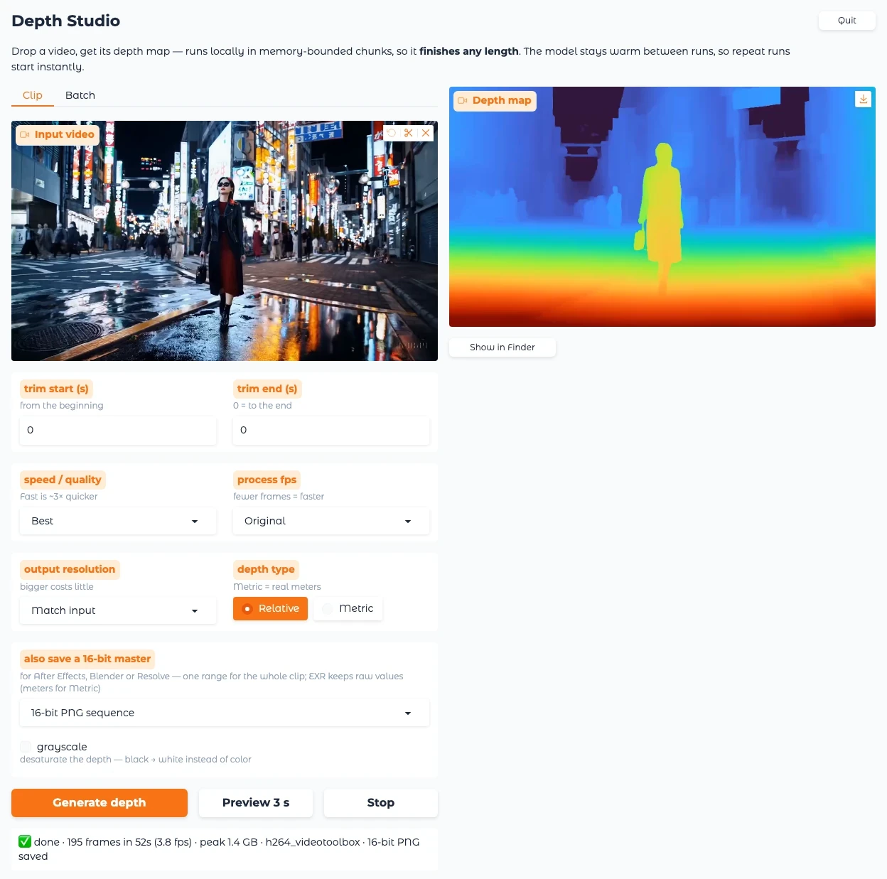
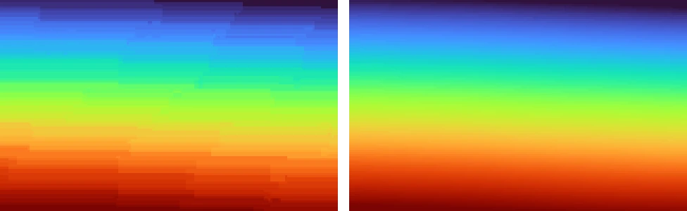
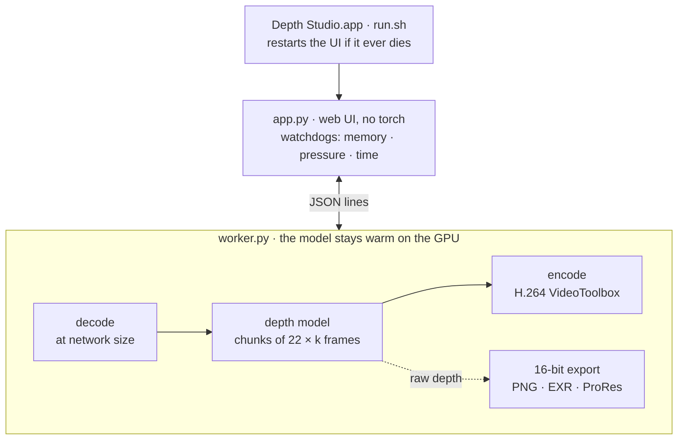

<p align="center">
  
</p>

<h1 align="center">Depth Studio</h1>

<p align="center">
  Video in, depth map out, on your Mac's own GPU.<br>
  Private, any length, and it never freezes the machine.
</p>

<p align="center">
  
</p>

## Quick start

```bash
git clone https://github.com/irfanabdulhameed/depth-master.git
cd depth-master
./setup.sh          # once: Python env, dependencies, model weights (~1.4 GB)
mac/make_app.sh     # optional: puts "Depth Studio" in ~/Applications
```

Double-click **Depth Studio**, or run `./run.sh` and open http://127.0.0.1:7860.
You need an Apple Silicon Mac (tuned on an M4 with 16 GB) and Python 3.11
(`brew install python@3.11`).

## What it does

- **Stable depth video.** Warm-to-cool colour or clean grayscale. Depth stays
  steady from frame to frame instead of flickering.
- **16-bit masters for compositing.** 16-bit PNG, raw EXR or ProRes 4444, ready
  for After Effects, Blender or Resolve.
- **Relative or metric depth.** Metric gives real distance in meters.
- **Batch, trim and a 3-second preview,** so you can check a setting before a
  long run.
- **Built for 16 GB.** Best quality runs at full resolution, and long clips use
  no more memory than short ones.
- **Nothing leaves your Mac.** No upload and no cloud GPU.

## The app

<picture>
  <source media="(prefers-color-scheme: dark)" srcset="docs/images/ui-dark.webp">
  
</picture>

| Control | What it does |
|---|---|
| **Clip / Batch** | One clip, or many clips with the same settings, one after another. |
| **Trim** | Start and end in seconds. An end of 0 means the end of the clip. |
| **Speed / quality** | Fast (~3× quicker), Balanced or Best. |
| **Process fps** | Original, 24 or 15. Fewer frames process proportionally faster. |
| **Output resolution** | Match input keeps every pixel aligned with the source for compositing. |
| **Depth type** | Relative, or Metric (meters). |
| **16-bit master** | None, PNG, EXR or ProRes. See below. |
| **Preview 3 s** | Renders three seconds at 540p from the trim start. |
| **Stop** | Ends the run and keeps a playable partial. In Batch it skips the remaining clips. |
| **Show in Finder · Quit · Free memory** | Reveal the result, shut down cleanly, or release memory. Free memory may ask for your password. |

Settings are remembered between sessions. The **Device usage** panel shows CPU,
RAM, swap, GPU use and a 🟢 🟡 🔴 light based on the Mac's real memory pressure.

## 16-bit masters

The MP4 preview is 8-bit. That's fine to watch, but it breaks into bands as soon
as a composite pushes it, for example when Levels isolates a slice of depth for
fog or depth of field. The 16-bit master stays smooth.

<p align="center">
  
  <br><sub>Same patch of street, same levels stretch, 3× zoom. Left: 8-bit MP4 preview. Right: 16-bit master.</sub>
</p>

| Format | Saved as | Values |
|---|---|---|
| **16-bit PNG** | `<clip>_depth_<n>_png16/depth_000001.png …` | 0–65535, near = white |
| **EXR** | `<clip>_depth_<n>_exr/depth_000001.exr …` | Raw float: relative inverse depth, or meters with Metric |
| **ProRes 4444** | `<clip>_depth_<n>_prores.mov` | 12-bit grayscale (hardware encoder), near = white |

PNG and ProRes use **one brightness range for the whole clip**, so a surface
never drifts between frames. Free disk space is checked before the run starts.

## Performance

M4, 16 GB, bundled 70-frame clip (960×540):

| | Before | Now |
|---|---|---|
| Balanced, warm | 16.8 s | **12.8 s** (5.5 fps) |
| Balanced, including startup | 39.4 s | **19.3 s** |
| Best | quality lowered to fit | **full quality**, 25.1 s |
| Peak memory | 0.75 GB | **0.46 GB** |

Run `.venv/bin/python bench.py worker` to measure your own Mac.

## How it works



- **One warm engine.** The model loads once. Decoding, inference and encoding run
  at the same time, in bounded memory.
- **Fused attention** never builds the full attention matrix. That cut GPU
  memory per window by ~45% and time by ~30%, which is what lets Best fit in
  16 GB.
- **Layered safety.** A GPU memory cap, a quality fit check before each run, and
  watchdogs that stop gracefully, keeping the partial, long before macOS would
  step in.

Measurements, rejected experiments (CoreML, `torch.compile`, streaming) and the
rules not to break are in **[docs/ARCHITECTURE.md](docs/ARCHITECTURE.md)**.

<details>
<summary><b>Development</b>: tests, benchmark, images, layout</summary>

```bash
.venv/bin/pip install -r requirements-dev.txt
.venv/bin/python -m pytest tests/ -q          # 20 end-to-end tests, ~2 min on the GPU
.venv/bin/python bench.py worker              # cold + warm timing, steady fps, peak memory
.venv/bin/python docs/make_images.py          # regenerate every README image from real output
```

The UI tests run on port 7861 with their own settings file, so an open Depth
Studio and your saved settings are never touched.

```
run.sh · setup.sh     start (self-restarting) · one-time setup with verified weights
app.py                web UI, device monitor, watchdogs
worker.py             warm depth engine and 16-bit export pass
bench.py · infer.py   benchmark · old one-shot pipeline (benchmark baseline only)
mac/                  builds Depth Studio.app and its icon
tests/                engine and web UI tests
docs/                 architecture notes, README images and their generator
vda/                  Video-Depth-Anything model code with local patches
```

</details>

<details>
<summary><b>Troubleshooting</b></summary>

| Problem | Fix |
|---|---|
| "Not set up yet", or the app offers to run setup | Run `./setup.sh`. |
| The app says the project folder moved | Run `mac/make_app.sh` again from the new location. |
| The first run is slow | The model is still loading. Give it ~10 s after launch. |
| A run stops with a memory message | Use **Fast**, a lower fps or a smaller resolution. The partial is kept. |
| "not enough disk space for the export" | Free some space, lower the resolution or trim the clip. |
| Port 7860 busy, or an old version still running | `lsof -nP -iTCP:7860 -sTCP:LISTEN -t \| xargs kill -9 && ./run.sh` |
| Anything else | `worker.log` has the engine's own output. |

</details>

## License

Depth Studio's own code is released under the [MIT License](LICENSE).

The model code in [`vda/`](vda/) is Video-Depth-Anything by ByteDance, under
**Apache-2.0** ([vda/LICENSE](vda/LICENSE)). The three files changed for Apple
Silicon say so in their headers, and [vda/VENDORED.md](vda/VENDORED.md) lists
the upstream commit and the full diff. `setup.sh` downloads the
**Video-Depth-Anything-Small** and **Metric-Video-Depth-Anything-Small**
weights, both Apache-2.0. The Base and Large weights are non-commercial and are
not used.

The demo clips and the README images made from them come from the clips bundled
with Video-Depth-Anything and remain their owners' work.
